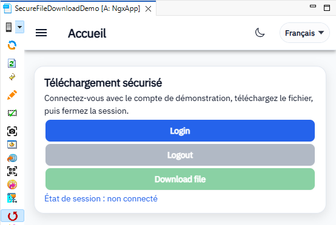
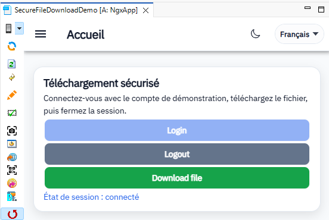
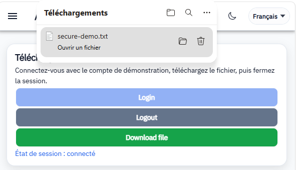

# SecureFileDownloadDemo

Démonstration Convertigo du téléchargement d’un fichier protégé : le répertoire secured/ est exclu de la publication HTTP directe par .httpignore ; la séquence GetSecuredFile, appelée en .bin, exige une session authentifiée et renvoie secure-demo.txt en pièce jointe. L’interface NGX propose Login, Logout et Download file et affiche l’état de session. Le login sans mot de passe est réservé à cette démonstration et doit être remplacé en production.


For more technical informations : [documentation](./project.md)

- [Installation](#installation)
- [Mobile Application](#mobile-application)
    - [Pages](#pages)
        - [Page](#page)


## Installation

1. In your Convertigo Studio click on  to import a project in the treeview
2. In the import wizard

   
   
   paste the text below into the `Project remote URL` field:
   <table>
     <tr><td>Usage</td><td>Click the copy button at the end of the line</td></tr>
     <tr><td>To contribute</td><td>

     ```
     SecureFileDownloadDemo=https://github.com/convertigo/c8oprj-demo-securefiledownload.git:branch=master
     ```
     </td></tr>
     <tr><td>To simply use</td><td>

     ```
     SecureFileDownloadDemo=https://github.com/convertigo/c8oprj-demo-securefiledownload/archive/master.zip
     ```
     </td></tr>
    </table>
3. Click the `Finish` button. This will automatically import the __SecureFileDownloadDemo__ project


## Mobile Application

Application de démonstration du téléchargement sécurisé de fichiers avec .httpignore et une séquence authentifiée appelée en .bin. La connexion proposée est pédagogique, sans mot de passe.

#### Aperçu de l’application







### Pages

#### Page

Page de démonstration du téléchargement sécurisé : affiche l’état connecté/non connecté et propose Login, Logout et Download file. La page reste accessible sans connexion pour permettre le login ; seul le téléchargement est protégé côté serveur.


